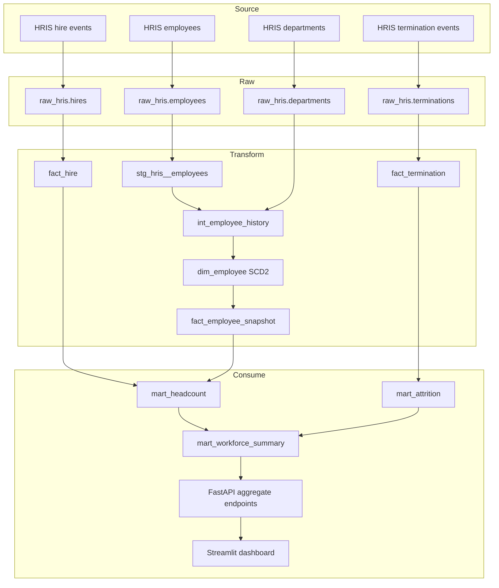

# Data flow and lineage

Lineage is declared in dbt `ref()`/`source()` relationships and exposed through
the manifest and governance API. The batch identifier links each raw record to
`audit.pipeline_batch`; model build artifacts link transformations to their
invocation.

Business-effective dates (`hire_date`, `termination_date`, `valid_from`,
`valid_to`) stay separate from technical load timestamps (`_ingested_at`,
`loaded_at`). Point-in-time queries use effective ranges, while freshness and
recovery use technical timestamps.

