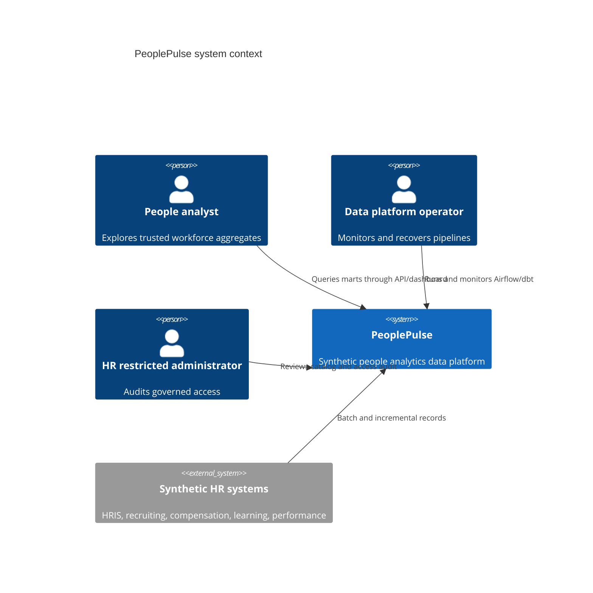
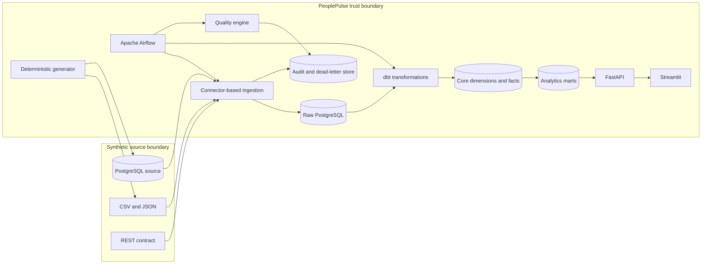

# PeoplePulse architecture

## Context

PeoplePulse turns synthetic lifecycle events into governed workforce metrics.
Source operators own the simulated HR systems, data engineers own ingestion and
the warehouse, people-analytics engineers own metric definitions, and analysts
consume only aggregate marts through the API and dashboard.



## Containers



## Warehouse layering

| Layer | Purpose | Mutability | Typical access |
|---|---|---|---|
| `raw_hris` | Source-faithful batches plus load metadata | Append/idempotent | Loader, transformer |
| `staging` | Types, normalized enums, deduplication, row hashes | Rebuilt views/tables | Transformer |
| `intermediate` | Reusable lifecycle logic and event derivations | dbt-managed | Transformer |
| `core` | Conformed SCD dimensions and atomic facts | Incremental | Restricted engineering |
| `marts` | Aggregate, business-defined workforce metrics | dbt-managed | API/reporting roles |
| `audit` | Batches, rejects, quality results, access events | Append | Operators/auditors |
| `governance` | Catalog, classification, retention policy | Controlled | Auditors/platform |

## Pipeline lifecycle

```mermaid
sequenceDiagram
    participant A as Airflow
    participant I as Ingestion
    participant R as Raw warehouse
    participant D as dbt
    participant Q as Quality
    participant P as API/dashboard
    A->>I: Start batch with logical date
    I->>I: Extract, validate, hash, deduplicate
    I->>R: Transactional idempotent load
    I-->>A: Counts, rejects, checkpoint
    A->>D: Build staging, core, facts, marts
    D->>Q: dbt and aggregate check results
    alt critical check fails
        Q-->>A: Fail publication; preserve evidence
    else only warnings or all pass
        Q-->>A: Publish quality summary
        A->>P: Metrics become available
    end
```

## Security boundaries

- Generated raw employee rows are treated as sensitive even though they are
  synthetic. Raw and core schemas are not analyst-facing.
- API workforce routes return aggregates. Admin mutation routes require a local
  bearer role token and are intentionally demo-only.
- Central field policies classify names, contact information, birth dates,
  employee identifiers, and salary as restricted or confidential.
- Logs, task XCom values, metrics labels, and RFC 7807 errors contain only safe
  counts and stable identifiers—never employee payloads.
- Secrets come from environment variables or a deployment secret manager. The
  committed `.env.example` contains local-only defaults.

## Failure handling

Extraction and loading are separated by validation. Records that fail a business
or schema rule are redacted into the dead-letter store; the batch can finish with
warnings if policy allows. Checkpoints advance only after a successful atomic
load and reconciliation. Airflow retries retryable infrastructure failures with
exponential backoff, limits database-heavy concurrency through a pool, and
allows a logical date to be replayed safely.

Critical quality failures stop publication after results are persisted. Because
raw batches remain available, operators can correct configuration or code and
replay from the last committed checkpoint.

